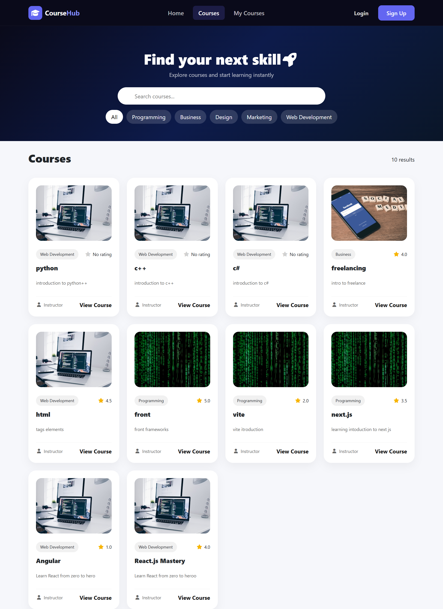
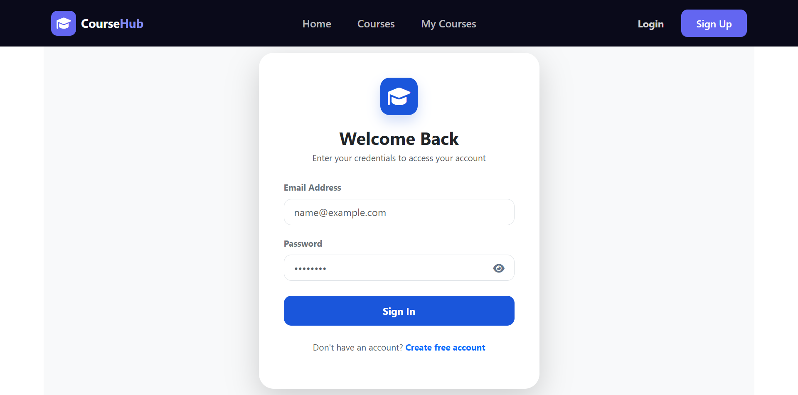
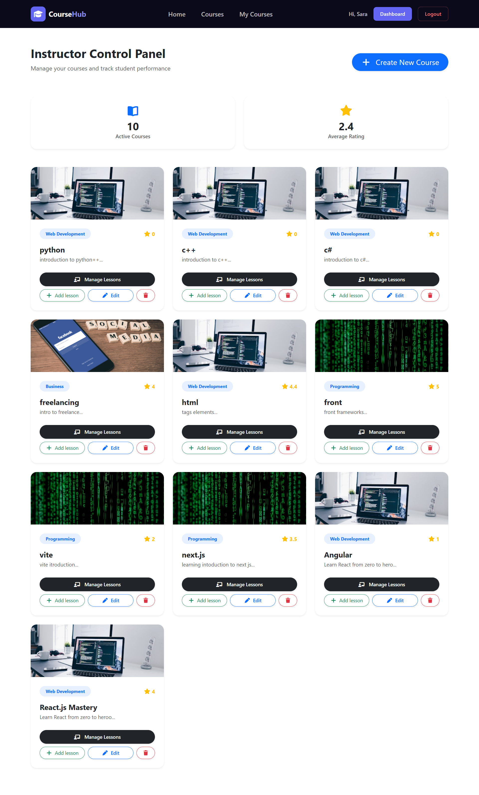
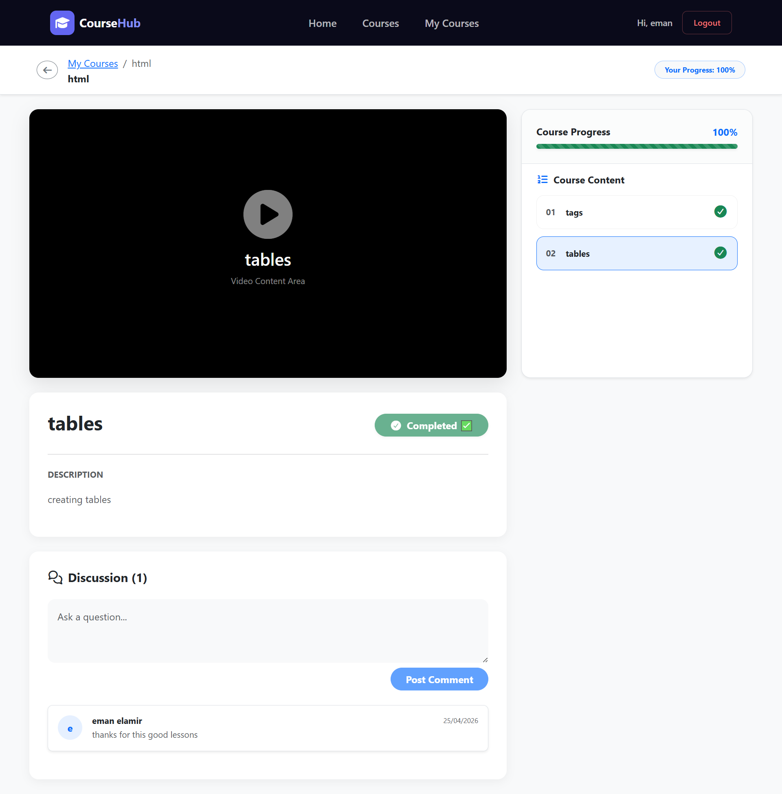

# 🎓 LMS Platform — Learning Management System

A full-stack Learning Management System (LMS) built with **React.js, Node.js, Express.js, and MongoDB**. The platform provides dedicated experiences for students and instructors, enabling course management, online learning, course enrollment, and learning progress tracking.

## 🌐 Live Demo

[**View LMS Platform Demo**](https://drive.google.com/file/d/1P-zxbsgPfSm6b5xGiTGu3VP9btJYhlOl/view)

## 📸 Screenshots

### 🏠 Home Page


### ✨ Hero Section


### 📚 Courses Page



### 🔐 Welcome Back Page



### 🎓 My Courses


### 📖 Lesson Page



### 🎬 Video Lesson Page



## ✨ Features

- 🔐 User authentication and protected access.
- 👥 Role-based access for students and instructors.
- 📚 Course and lesson management.
- 🎓 Course enrollment for students.
- 🎬 Online video lessons.
- ⭐ Course rating and reviews.
- 📊 Learning progress tracking.

## 🛠️ Tech Stack

**Frontend**
- React.js
- Vite
- JavaScript (ES6+)
- CSS

**Backend**
- Node.js
- Express.js
- MongoDB
- Mongoose
- RESTful APIs

**Tools**
- Git & GitHub
- npm

## 📂 Project Structure

```text
lms-platform/
├── nodeee/                 # Backend
├── public/                 # Public assets
├── screenshots/            # Project screenshots
├── src/                    # Frontend source code
├── index.html
├── package.json
└── vite.config.js
```

## 🚀 Getting Started

### Prerequisites

- Node.js and npm
- MongoDB or a MongoDB Atlas database

### 1. Clone the Repository

```bash
git clone https://github.com/saraelamir/lms-platform.git
cd lms-platform
```

### 2. Install Frontend Dependencies

```bash
npm install
```

### 3. Start the Frontend

```bash
npm run dev
```

The frontend will usually run at `http://localhost:5173`.

### 4. Start the Backend

Open another terminal:

```bash
cd nodeee
npm install
```

Configure your environment variables using the backend's `.env.example` file, then run the appropriate start command defined in `nodeee/package.json`.

## 🔑 Environment Variables

Check `nodeee/.env.example` for the exact environment variables required by the backend.

**Important:** Never upload your real `.env` file or expose database credentials and secret keys.

## 🎯 Project Overview

This project showcases full-stack web development skills, including building interactive React interfaces, developing REST APIs, integrating MongoDB, and implementing student and instructor workflows.

## 👩‍💻 Author

**Sara El-Amir**

- GitHub: [@saraelamir](https://github.com/saraelamir)
- LinkedIn: [Sara El-Amir](https://www.linkedin.com/in/saraa-elamir/)

---

⭐ Thank you for checking out the project!
